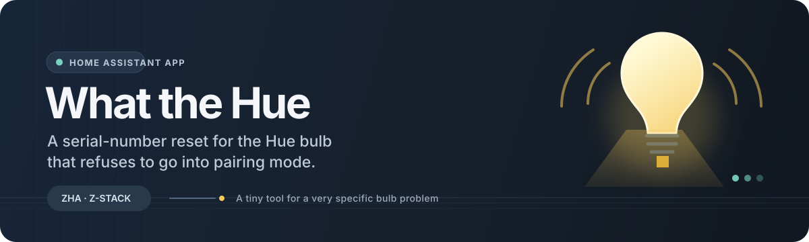
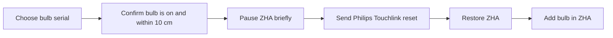

### Get a stubborn Hue bulb back into pairing mode

What the Hue sends a serial-number Touchlink reset from your Home Assistant Z-Stack coordinator, then brings ZHA back up so you can pair the bulb again.

> **Quick install:** click the Home Assistant button above to add the repository. Then find **What the Hue** in **Settings → Apps → App Store**, install it, and choose the same Zigbee USB coordinator that ZHA uses.

## What it does

Some Philips Hue bulbs ignore the usual power-cycle reset sequence. What the Hue sends the Philips serial-number reset over Zigbee Touchlink. You enter the six-character serial printed on the bulb, keep the bulb powered on close to the coordinator, and start the reset from a small Home Assistant app page.

During the reset, the app briefly unloads ZHA to release its coordinator, sends the command across Zigbee channels 11–26, then re-enables ZHA. When ZHA is back, add the bulb from **Settings → Devices & services → ZHA → Add device**.

## Requirements

| Requirement | Details |
| --- | --- |
| Home Assistant | Home Assistant OS or Supervised, with the Apps store |
| Zigbee integration | ZHA must be loaded and using the coordinator you select in this app |
| Coordinator | A TI Z-Stack adapter, such as the Sonoff Zigbee 3.0 USB Dongle Plus **Dongle-P** |
| Bulb | Powered on, with its six-character hexadecimal serial number available |
| Proximity | Place the bulb within **10 cm** of the coordinator for the reset |

**Not supported:** Silicon Labs Ember adapters, including the Sonoff Dongle-E. This app opens the coordinator with the Z-Stack driver; it cannot safely control another adapter family.

## Install and configure

### 1. Add the app repository

Use the **Add repository** button at the top of this page. If the button does not open the repository dialog in your Home Assistant version, add it manually:

1. Open **Settings → Apps → App Store**.
2. Open the menu in the upper-right corner, choose **Repositories**, then **Add**.
3. Enter `https://github.com/DrB0rk/what-the-hue` and submit.

### 2. Install What the Hue

Find **What the Hue** in the App Store and install it. Open its **Configuration** tab and choose the same stable serial device that ZHA uses, preferably a `/dev/serial/by-id/...` path. Save the configuration, start the app, and select **Open Web UI**.

### 3. Reset and pair the bulb

1. Read the six hexadecimal characters from the bulb label, for example `92F796`.
2. Enter the serial twice in the app so the two values match.
3. Switch the bulb on and place it within 10 cm of the coordinator.
4. Confirm the proximity checkbox and choose **Send reset to this bulb**.
5. Leave the bulb and coordinator powered. Wait for the operation log to say **ZHA is loaded again**.
6. In Home Assistant, open **Settings → Devices & services → ZHA → Add device** and pair the bulb.

The channel sweep takes about 20 seconds. Do not stop the app or unplug the coordinator during the reset.

## Safety and privacy

- The app does nothing to the coordinator until you submit a reset.
- Home Assistant grants the app Core API access so it can request a ZHA network backup and unload/reload ZHA. Treat this as administrator-level access.
- The app reads the network's extended PAN ID from the backup. It does not store the backup or network key.
- The bulb serial stays in memory for the operation. The app does not save it to disk.
- The app opens the configured coordinator directly while ZHA is unloaded. Do not run another coordinator tool at the same time.
- If an error happens after ZHA unloads, the app attempts to restore it. If ZHA does not return, reload ZHA from **Settings → Devices & services → ZHA**.

## Troubleshooting

The app says no coordinator is selected

Open the app's **Configuration** tab, choose the same USB serial device used by ZHA, save, and restart the app. Prefer the stable `/dev/serial/by-id/...` entry when it is available.

The app says ZHA is not loaded

Check that ZHA and its coordinator are working, then refresh the app page. What the Hue only runs while it finds exactly one loaded ZHA entry.

The bulb does not react

Check the serial on the bulb itself, switch it on, and move it closer to the dongle. Run the reset again if needed. A powered fixture or enclosure can reduce Zigbee range.

ZHA did not come back

Open **Settings → Devices & services → ZHA** and reload the integration. If ZHA still cannot load, restart Home Assistant. Do not start another process that opens the coordinator while ZHA recovers.

## Project links

- [Full app guide](what_the_hue/DOCS.md)
- [Report an issue](https://github.com/DrB0rk/what-the-hue/issues)
- [Source code](https://github.com/DrB0rk/what-the-hue)
- [MIT license](LICENSE)

Made for the one bulb that just would not reset.

